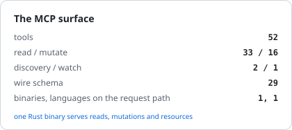
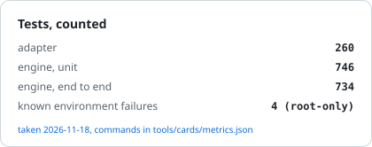
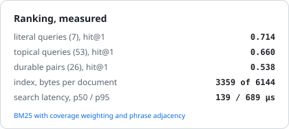
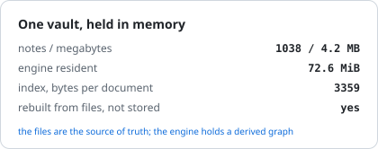

# 2brain

A typed knowledge engine over markdown, and the MCP server agents read and write it through — one Rust
binary, one language on the request path, files as the source of truth.

> **Status: alpha.** The engine, the MCP surface and the write gate are in daily use against a live
> vault; the on-disk format still carries its pre-fork naming and is being migrated in steps
> (`docs/rebrand-plan.md`). Interfaces may change between releases; the wire schema is versioned and
> refuses a mismatch rather than guessing.

## What it is

- **An engine.** Markdown notes claim a type, link each other with `[[wiki-links]]` and carry addressable
  `^block-ids`; the engine parses them into a typed graph, answers queries over it (graph reads, a BM25
  index with phrase adjacency, diagnostics), and writes back through one authority.
- **An MCP server.** `2brain` exposes that graph to agents: 52 tools, engine results in their own shape,
  resources per file, a discovery ladder. Mutation tools exist only when the operator grants them.
- **A fail-closed write path.** Every write is checked against a gate that names the stage it failed at
  (`policy/prior_read: read this file with au_content before writing it`), and a lost reply is
  `outcome_unknown` — never retried, reconciled instead.

## What it is not

- Not a database: the files are the truth, the graph is derived and rebuilt from them.
- Not a note-taking app: there is no editor, no UI, no sync daemon.
- Not a general search engine: ranking is tuned for a personal knowledge base and measured against one
  (`tools/ranking/`).
- Not permissive by default: an agent that launches read-only cannot write, and cannot find a tool that
  would let it.

## State

[](https://github.com/rager306/2brain/actions/workflows/ci.yml)

Every number on these cards comes from `tools/cards/metrics.json`, which records the command it was
measured with and the date. `tools/cards/render.py --check` runs in CI, so a card cannot drift from its
number.

<p align="center">
<picture>
  <source media="(prefers-color-scheme: dark)" srcset="assets/cards/surface-dark.svg">
  
</picture>
<picture>
  <source media="(prefers-color-scheme: dark)" srcset="assets/cards/gates-dark.svg">
  
</picture>
</p>
<p align="center">
<picture>
  <source media="(prefers-color-scheme: dark)" srcset="assets/cards/ranking-dark.svg">
  
</picture>
<picture>
  <source media="(prefers-color-scheme: dark)" srcset="assets/cards/memory-dark.svg">
  
</picture>
</p>

## Quickstart

**Prerequisites.** Linux or macOS with a Unix domain socket; [Rust 1.99.0](https://rustup.rs) (pinned in
`tb-engine/rust-toolchain.toml`); `git` for the daemon's write path. No database, no service to install.

**Build from source.**

```sh
git clone https://github.com/rager306/2brain && cd 2brain
(cd tb-engine && cargo +1.99.0 build --release -p tb-cli)   # the engine binary: tb-engine/target/release/au
(cd tb-mcp-rs && ./scripts/install.sh)                      # the MCP server: /usr/local/bin/2brain
export PATH="$PWD/tb-engine/target/release:$PATH"           # or copy `au` somewhere on PATH
```

**Point it at a workspace and start the engine.**

```sh
mkdir -p ~/my-vault && cd ~/my-vault && git init
mkdir -p .2brain                                 # the identity directory a repository carries
printf 'name: my-vault\ntype: au.engine.repo::au-engine\n' > .2brain/repo.yaml
au daemon start ~/my-vault                       # serves reads over a socket under ~/.arsumbris/au-engine/run
2brain info ~/my-vault                           # surface, members, diagnostics — and a probe of that daemon
```

The daemon's state root is `~/.2brain/` when that directory exists and `~/.arsumbris/` otherwise — the second
spelling is the one a fresh machine gets in this release, and the migration to the first is a separate step
(`docs/naming.md`). A workspace with one note and a broken `[[link]]` reports three diagnostics rather than
failing: diagnostics describe content, they do not block serving.

**Connect an MCP client.** Any client that speaks MCP over stdio takes the same entry; this is the shape
Claude Desktop, Hermes and others use:

```json
{
  "mcpServers": {
    "2brain": {
      "command": "/usr/local/bin/2brain",
      "args": ["mcp", "/root/my-vault", "--allow-mutations", "--principal", "my-client"]
    }
  }
}
```

Drop `--allow-mutations` for a read-only launch: the 16 mutating tools are then absent from `tools/list`,
not merely refused. `--allow-composition` and `--allow-workspace-shape` add the tools that change a
workspace's structure.

**First calls**, from an agent or a person using an MCP client: `au_overview` (what is here),
`au_members` (which member is editable), `au_types` (the vocabulary), `au_search` (find by meaning),
`au_content` (read a file and get the hash a write will need).

## Concepts

| term | meaning |
|---|---|
| **workspace** | a directory tree the engine serves; its members are discovered from it |
| **member** | one repository inside the workspace, with its own root and its own `.2brain/repo.yaml` |
| **type** | a declared shape a note claims in frontmatter (`type: note`), resolved against type definitions |
| **claim** | the `type:` a file states; an unresolvable claim is a diagnostic, not an error |
| **block id** | `^id` on a paragraph or record, addressing it for links and for edits |
| **version** | the engine's monotonic build counter; every read answer carries it, so a client can tell it moved |
| **diagnostic** | the engine's own complaint about content (`reference-target-missing`, `duplicate-field`, …) |

## The MCP surface

| capability | count | notes |
|---|---:|---|
| read | 33 | engine reads plus derived ones (ranked search, follow, typed resolution) |
| mutate | 16 | behind `--allow-mutations`; each needs a prior read of the same path and the hash it returned |
| discover | 2 | `au_search_tools`, `au_describe_tool` — answer without touching the engine |
| watch | 1 | `au_watch` reports the engine's change events; there are no subscriptions |

Every result is the engine's own object under the read's key (`au_search` → `{"search": …}`), carried both
as text and as `structuredContent` that validates against the declared `outputSchema`. Reads are paged
where the answer can grow; a page that ends a sequence reports `next_offset: null`.

The full catalog, generated from the running binary: [`tb-mcp-rs/skills/2brain/references/tool-map.md`](tb-mcp-rs/skills/2brain/references/tool-map.md).

## For agents

This repository is meant to be read by agents, not only by people. Start here, in this order:

| entry point | what it answers |
|---|---|
| [`llms.txt`](llms.txt) | the same map in the `llms.txt` format: what this is, where the detailed documents are |
| [`AGENTS.md`](AGENTS.md) | how to work in this repository: the layers, the live-system rules, the gates |
| [`tb-mcp-rs/skills/2brain/SKILL.md`](tb-mcp-rs/skills/2brain/SKILL.md) | how to *use* the server: the tool ladder, the result envelope, the read-then-write loop, the recovery path |
| [`tb-engine/crates/tb-engine/WIRE.md`](tb-engine/crates/tb-engine/WIRE.md) | the engine wire protocol, verb by verb |
| [`tb-mcp-rs/docs/verification.md`](tb-mcp-rs/docs/verification.md) | the evidence index: every claim here, the command that re-measures it, the date |
| [`docs/trajectory.md`](docs/trajectory.md) | what is done, what is open, and what was measured and rejected |

## Layout

| path | role |
|---|---|
| `tb-engine/` | the engine: parser, type graph, diagnostics, daemon, wire, the BM25 index (crates `tb-cli`, `tb-engine`, `tb-core`, `tb-parser`, `tb-grammar`, `tb-references`, `tb-diagnostics`, `tb-testkit`) |
| `tb-mcp-rs/` | **the serving path**: the MCP adapter behind `/usr/local/bin/2brain` |
| `tb-mcp-sdk/` | the `mcp.*` type vocabulary content notes are written in (`mcp.skill`, `mcp.inject`, …) |
| `tb-defaults/` | workspace bundles: `minimal`, `blank`, `studio`, `host-bundle`, `mcp-bundle` |
| `tb-type-system/`, `tb-base-types/` | the type-system contract and the base ontology |
| `tb-ingest/`, `tb-govern/` | ingest contracts, workspace composition |
| `tb-rules/`, `tb-skills/`, `tb-agent-guides/`, `tb-writing-style/`, `tb-competency/` | content: rules, skills, guides, style, competency |
| `tb-weave/`, `tb-tree-research/` | domain knowledge repositories |
| `upstream/` | the upstream project's own documentation, kept verbatim as an archive |
| `docs/` | design: architecture, trajectory, research, the evidence index; operations live in `docs/internal/` |
| `tools/` | tooling that never runs on the request path: ranking evaluation, cards, judgement probes |

The engine's on-disk format still uses its historical `au.engine.*` schema names and `.arsumbris/`
identity directories. That is a **format**, not a brand: it is read and written as-is, and moving it is a
migration with its own gate (`docs/rebrand-plan.md`, tier C).

## Development

```sh
cd tb-engine && cargo +1.99.0 test --lib          # engine unit tests
cd tb-engine && cargo +1.99.0 test --test it      # end-to-end, on tempdir fixtures
cd tb-mcp-rs && cargo +1.99.0 test                # the MCP adapter
cd tb-mcp-rs && cargo +1.99.0 fmt --check && cargo +1.99.0 clippy --all-targets -- -D warnings
```

Four engine tests are known to fail **as root** on some hosts because `chmod` cannot block uid 0; they pass
for an unprivileged runner and are listed, name by name, in `tb-engine/tests-known-environment.txt`.
`scripts/run-known-root-tests.sh` re-runs exactly those as `nobody`.

Ranking changes are measured before they ship: `tools/ranking/eval.py` scores a labelled set, and
`tools/ranking/candidate_engine.py` runs a second engine over a copy of the vault so a change can be
compared without touching the served one.

## Releases and changelog

[`CHANGELOG.md`](CHANGELOG.md) follows [Keep a Changelog](https://keepachangelog.com/en/1.1.0/) and
[Semantic Versioning](https://semver.org/spec/v2.0.0.html). The binary reports its version **and the commit
it was built from** (`2brain --version` → `2brain 0.1.0+<sha>`), so a deployed binary always names its
source.

## License

This is a monorepo with mixed licensing; [`LICENSE.md`](LICENSE.md) is the map. In short: the engine and
the MCP server are **Sustainable Use 1.0** (not OSI-approved — internal, personal, non-commercial use, no
paid hosting of it), the other `tb-*` content repositories are **MIT**, and `upstream/` keeps the original
terms.

## Lineage

2brain is a fork of the **arsumbris** project — a typed knowledge-graph engine over markdown workspaces with
`[[wiki-links]]`, `^block-ids` and frontmatter type contracts: <https://github.com/arsumbris>. That project
stopped receiving changes after `0.0.2-alpha` (last commit 2026-09-25); its `0.0.5`-era work is preserved
here as the tag `archive/upstream-0.0.5` (commit `44b32f4`). Everything since — the Rust MCP serving path,
the BM25 index, the fail-closed write gate, the retirement of the TypeScript and Python layers, the
identity migration — is 2brain's own.
